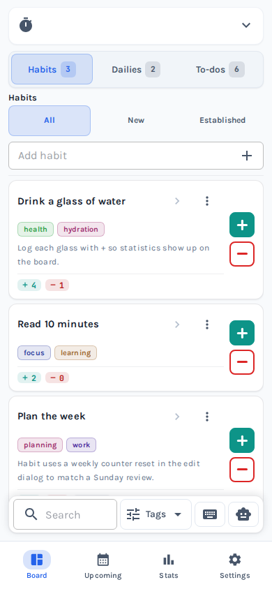
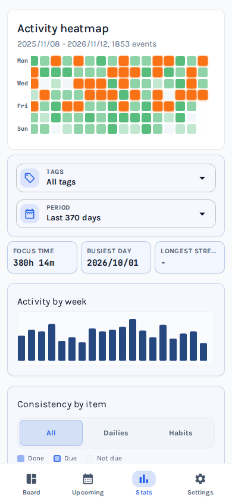
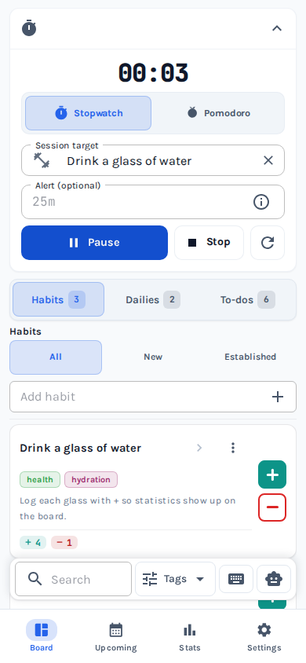
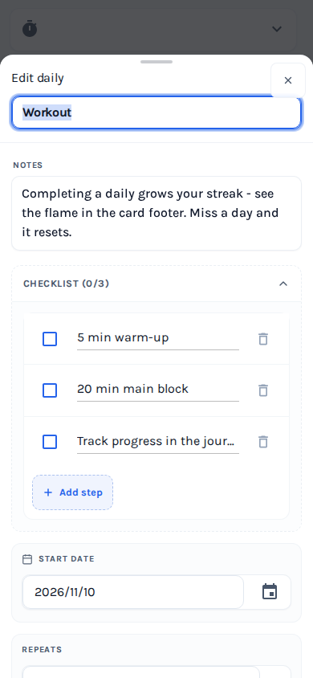
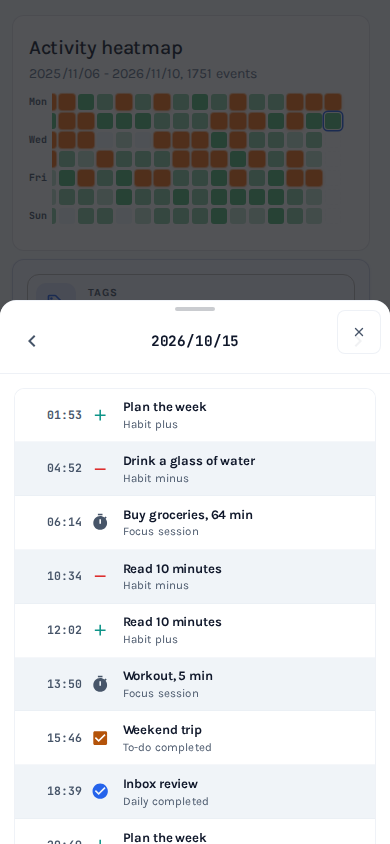
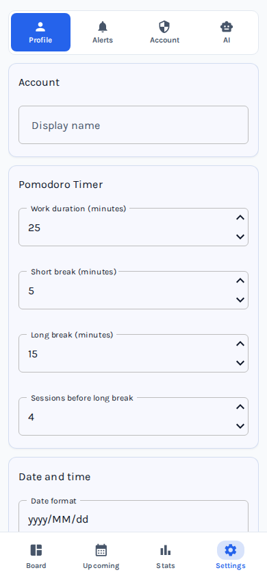
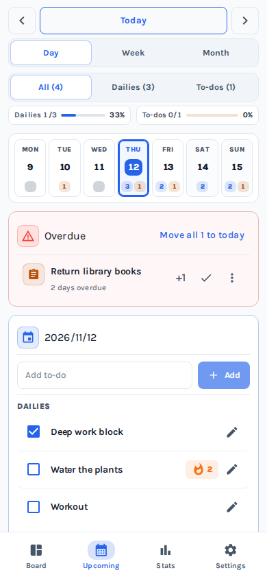
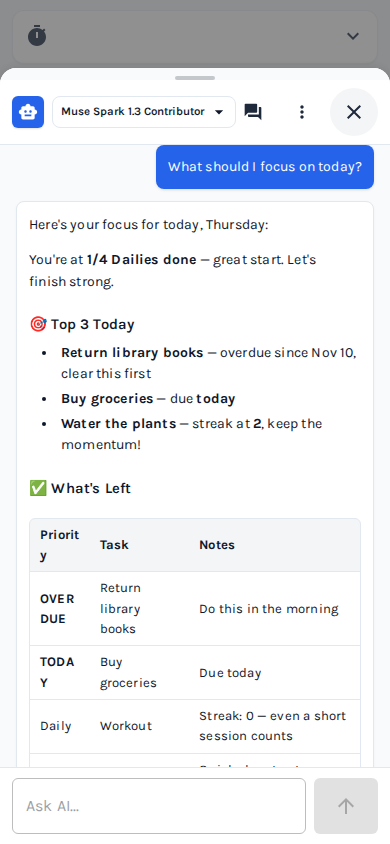
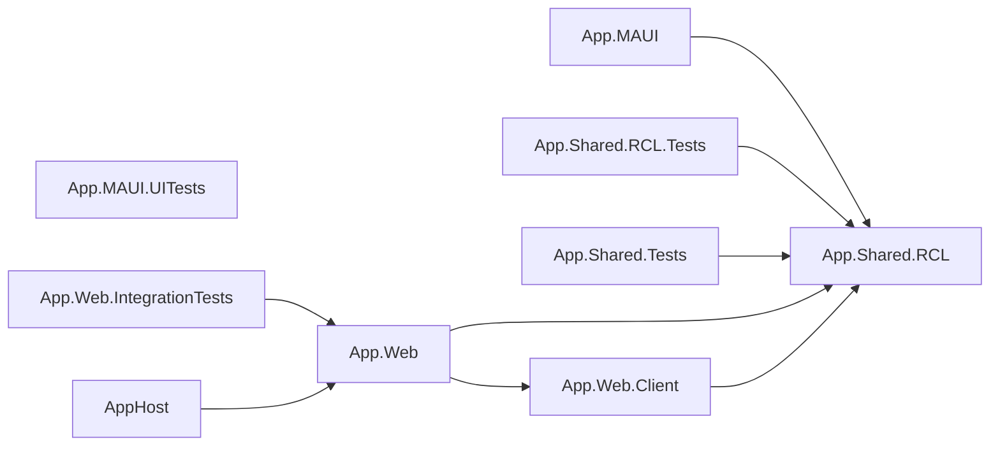

# Habitinator

<div align="center">


[](https://github.com/kadato/Habitinator/releases/latest)

A cross-platform productivity app built with .NET MAUI and Blazor. Manage habits, dailies, and to-dos with a focus timer, analytics, and reliable sync across web and mobile.

**Live Demo.** [habitinator.app](https://habitinator.app)

[Demo](https://habitinator.app) | [Preview](#preview) | [Download](#download-and-install) | [Features](#key-features) | [Tech stack](#technology-stack)

</div>

---

## Preview

<div align="center">

<p align="center">
<strong>Board</strong> | <strong>Statistics</strong> | <strong>Focus timer</strong><br><br>
<picture>
  <source media="(prefers-color-scheme: dark)" srcset="./docs/automation/screenshots/board-dark.png">
  
</picture>
&nbsp;&nbsp;
<picture>
  <source media="(prefers-color-scheme: dark)" srcset="./docs/automation/screenshots/statistics-dark.png">
  
</picture>
&nbsp;&nbsp;
<picture>
  <source media="(prefers-color-scheme: dark)" srcset="./docs/automation/screenshots/timer-dark.png">
  
</picture>
</p>

<br>

<p align="center">
<strong>Edit daily</strong> | <strong>Activity day detail</strong> | <strong>Settings</strong><br><br>
<picture>
  <source media="(prefers-color-scheme: dark)" srcset="./docs/automation/screenshots/edit-daily-dark.png">
  
</picture>
&nbsp;&nbsp;
<picture>
  <source media="(prefers-color-scheme: dark)" srcset="./docs/automation/screenshots/activity-day-detail-dark.png">
  
</picture>
&nbsp;&nbsp;
<picture>
  <source media="(prefers-color-scheme: dark)" srcset="./docs/automation/screenshots/settings-dark.png">
  
</picture>
</p>

<br>

<p align="center">
<strong>Upcoming</strong> | <strong>AI assistant</strong><br><br>
<picture>
  <source media="(prefers-color-scheme: dark)" srcset="./docs/automation/screenshots/upcoming-dark.png">
  
</picture>
&nbsp;&nbsp;
<picture>
  <source media="(prefers-color-scheme: dark)" srcset="./docs/automation/screenshots/ai-assistant-dark.png">
  
</picture>
</p>

</div>

To regenerate these shots, run `pwsh ./tools/Habitinator.Screenshots/run.ps1` from the repo root. The script drives Playwright with a mobile viewport in light and dark themes.

---

## Download and install

Download the latest build from the [releases page](https://github.com/kadato/Habitinator/releases/latest), or use the direct links below. Every package ships with a SHA256 checksum file.

| Platform | Package | Size | Notes |
|----------|---------|------|-------|
| Android | [](https://github.com/kadato/Habitinator/releases/latest/download/Habitinator-android.apk) | 41 MB | Install on device. Enable unknown sources first |
| Windows | [](https://github.com/kadato/Habitinator/releases/latest/download/Habitinator-windows-x64-setup.exe) | 53 MB | Installer with auto-updates. Recommended |
| Windows | [](https://github.com/kadato/Habitinator/releases/latest/download/Habitinator-windows-x64.zip) | 78 MB | Portable. Extract and run |
| iOS and macOS | *Source only* | - | Build from source using the .NET MAUI workload |
| Web | [](https://habitinator.app) | - | Live demo, no install needed |

**Windows runtime note.** If your release is framework-dependent, install [.NET Desktop Runtime](https://dotnet.microsoft.com/download/dotnet/11.0) once.

#### Option 1: Prebuilt packages, recommended

1. Pick your platform from the table above
2. Download the package and its `.sha256` file
3. Verify the checksum, then follow the platform steps below

#### Option 2: Build from source

```powershell
# Windows
dotnet build -t:Run -f net11.0-windows10.0.19041.0

# Android, requires the Android SDK
dotnet build -t:Run -f net11.0-android
```

### Installation instructions

#### Android

1. Enable Install from unknown sources in system settings
2. Transfer the APK to your phone
3. Open the APK and install

#### Windows

**Installer.** Run `Habitinator-windows-x64-setup.exe` and follow the setup wizard. It keeps the app updated.

**Portable.** Extract the ZIP file, then run `Habitinator.exe`. If prompted, install .NET Desktop Runtime.

---

## Key features

- **Board planner.** Track habits, dailies, and to-dos. Organize them with tags, notes, checklists, archive, and streaks.
- **Upcoming view.** See overdue, due today, and due tomorrow todos in one digest.
- **Focus timer.** Run stopwatch or Pomodoro sessions with per-item targets. Log sessions to activity.
- **Statistics.** Browse the activity heatmap. Open any day for details.
- **Command palette.** Press Ctrl+K or Cmd+K to jump anywhere. Board shortcuts cover the rest.
- **AI assistant.** Chat with the board from the drawer. Pick provider and model. Set custom instructions.
- **External AI access.** Connect Claude, Cursor, VS Code, or OpenCode over MCP with OAuth or personal tokens.
- **Reminders.** Set a daily reminder, focus timer alerts, sync alerts, sound, and quiet hours.
- **Local-first sync.** Each device keeps a mirror and an outbox queue. Pause sync and inspect pending work. Conflicts resolve without data loss.

---

## Technology stack

| Layer | Technologies |
|-------|--------------|
| **Runtime** | .NET 11 |
| **Web UI** | Blazor Web App with Interactive WebAssembly, MudBlazor |
| **Native Apps** | .NET MAUI + Blazor Hybrid for Android, iOS, macOS, Windows |
| **Database, Server** | Neon Serverless PostgreSQL or any PostgreSQL via EF Core |
| **Database, Client** | SQLite via EF Core, IndexedDB in the browser |
| **Orchestration** | .NET Aspire AppHost |

---

## Solution graph

Here are the project dependencies. `scripts/Refresh-AutomationAssets.ps1` syncs the diagram below from `docs/automation/solution-graph.mmd`:

<!-- HABITINATOR_MERMAID_BEGIN:solution-graph -->

<!-- HABITINATOR_MERMAID_END:solution-graph -->
